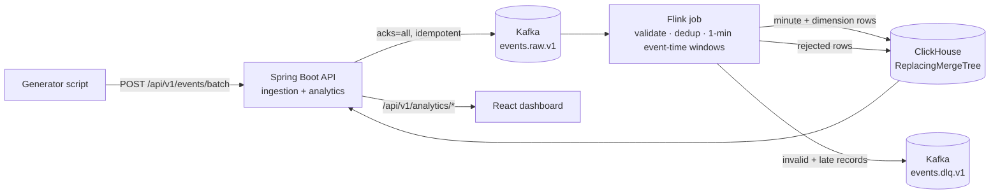

# StreamForge: Real-Time Event Analytics Platform

A working event-streaming pipeline for simulated e-commerce activity. Events enter through a validating
REST API, are durably written to **Kafka**, processed by an **Apache Flink** job (validation, deduplication,
event-time windows, late-event handling, dead-letter routing), stored in **ClickHouse**, and shown on a
live **React** dashboard.

Everything runs locally with Docker. Every number on the dashboard comes from the real pipeline.

## Architecture



| Stage | Meaning of "done" |
|---|---|
| **Ingestion acknowledgment** (HTTP 202) | Kafka acknowledged the record with `acks=all`. Says nothing about processing. |
| **Stream processing** | Flink consumed it, validated it, and included it in a window result (or rejected it). |
| **Analytics persistence** | The window result was written to ClickHouse and is visible via the API (typically within ~5 s). |

## Quick start

Prerequisites: Docker with Compose v2 and about 8 GB of memory available to Docker.

```bash
docker compose up --build -d
```

First start builds three images (a few minutes). Topics and tables are created automatically.

| What | URL |
|---|---|
| Dashboard | http://localhost:3000 |
| API docs (Swagger) | http://localhost:8080/api/v1/docs |
| OpenAPI JSON | http://localhost:8080/api/v1/openapi |
| Flink UI | http://localhost:8081 |
| Prometheus-format metrics | http://localhost:8080/actuator/prometheus |

Generate traffic (Python 3 standard library only):

```bash
python3 generator/generate.py --rate 20 --duration 120 --seed 42 --duplicate-rate 0.05 --invalid-rate 0.03 --late-rate 0.03 --too-late-rate 0.02
```

Send one event by hand:

```bash
curl -i -X POST localhost:8080/api/v1/events -H 'Content-Type: application/json' -d '{
  "eventId":"evt-demo-0001","eventType":"PURCHASE_COMPLETED","eventTimestamp":"'"$(date -u +%Y-%m-%dT%H:%M:%SZ)"'",
  "userId":"user-1","sessionId":"sess-1","productId":"prod-1","category":"books","quantity":1,
  "amount":19.99,"currency":"USD","deviceType":"MOBILE","region":"US-EAST","source":"web","schemaVersion":1}'
```

Stop everything (`-v` also deletes stored data):

```bash
docker compose down
```

## Event contract (v1)

Types: `PAGE_VIEW`, `PRODUCT_VIEW`, `ADD_TO_CART`, `CHECKOUT_STARTED`, `PURCHASE_COMPLETED`, `PURCHASE_FAILED`.

- `eventId`: 8-64 chars of `[A-Za-z0-9_-]`, unique per event (used for deduplication).
- `eventTimestamp`: ISO-8601 UTC. Rejected if more than 5 min in the future or older than 7 days.
- `amount`: positive decimal, at most 2 decimals, **USD only** (other currencies are rejected, so revenue is never a mixed-currency sum). Money is `BigDecimal` in Java and `Decimal(18,2)` in ClickHouse; no floats.
- Event-specific fields: `PRODUCT_VIEW` needs productId + category; `ADD_TO_CART` also quantity; `PURCHASE_COMPLETED` also amount + USD.
- Errors are RFC 7807 JSON: 400 for invalid input, 503 when Kafka or ClickHouse is unavailable.

## How the pipeline handles the hard parts

- **Deduplication:** keyed state per `eventId`, expiring 1 hour after first sight. A duplicate arriving more than an hour later is not detected.
- **Event time:** 1-minute tumbling windows on `eventTimestamp`; watermark = max event time minus 10 s; **2 minutes of allowed lateness**. Events beyond that are routed to `events.dlq.v1` (kind `LATE`) and counted, never silently dropped.
- **Revisions:** a window re-fires every ~5 s while data arrives (provisional) and again when a late event lands. Each firing carries a strictly increasing `revision`; ClickHouse `ReplacingMergeTree(revision)` keeps the latest, and every query uses `FINAL`. Replays and late updates therefore do not double-count.
- **Exact vs approximate:** all counts and "active users" (distinct users within one window) are exact. Active users are not additive across windows, so the dashboard shows only the latest minute.
- **Conversion:** `purchases completed ÷ checkouts started` over the selected range; shown as n/a when the denominator is 0.
- **Invalid records:** validated at the API and again in Flink (Kafka is a trust boundary). Bad records go to the DLQ topic and the `rejected_events` table.
- **Fault tolerance:** Flink checkpoints every 10 s; restart strategy is 60 attempts, 5 s apart; ClickHouse inserts retry 5 times with backoff, then fail the task so Flink restores and replays.

## Delivery guarantees (what is and is not claimed)

| Hop | Guarantee |
|---|---|
| Client → API → Kafka | At-least-once. Idempotent producer, `acks=all`, bounded retries; a 503 means "not acknowledged, safe to retry". |
| Kafka → Flink | Exactly-once *state* via checkpoints and committed offsets. |
| Flink → ClickHouse | At-least-once writes, made idempotent for window results by revisions. `rejected_events` is a plain table and can contain duplicate rows after a replay. |
| Flink → DLQ topic | At-least-once. |

The system as a whole is **not** claimed to be end-to-end exactly-once.

## Verified results (run on the author's Mac, 4 CPUs / 8.7 GB Colima VM)

These are measured, not estimated.

- Unit tests: **13 passing** (Flink module 6, API 7). Frontend: TypeScript strict typecheck and production build pass.
- End-to-end run, 60 s at about 20 events/s with injected faults: the API accepted 1,191 of 1,238 events and rejected 47 (45 injected-invalid plus 2 duplicates of invalid events); no publish failures. The raw topic held exactly 1,191 records. Flink put 1,118 into windows, dropped 56 as duplicates and 17 as too late: **1,118 + 56 + 17 = 1,191**, nothing lost.
- Flink's own invalid-record path: two malformed records written straight to Kafka both appeared in `events.dlq.v1` and `rejected_events`.
- Recovery test: restarted the Flink task manager mid-stream during a 30 s run. 446 events acknowledged, **446 counted in windows**: no loss, no double counting.
- Dashboard verified in a browser against live data, with no console errors. Logs scanned: no unexpected exceptions.

## Running the tests

```bash
export JAVA_HOME=$(/usr/libexec/java_home -v 21)
(cd streaming/flink-job && mvn -B test)
(cd backend/api && mvn -B test)
(cd frontend && npm ci && npm run typecheck && npm run build)
```

## Design notes and limitations

- Flink 1.20 with `flink-connector-kafka 3.4.0-1.20` (the matching official connector); ClickHouse is written over its HTTP interface instead of a JDBC connector to avoid driver/version coupling.
- The ingestion and analytics endpoints live in one Spring Boot service (no practical reason to split at this size).
- Window state is kept per window until cleanup (fine at this scale, not for very high rates).
- A full Flink *cluster* restart does not resume state (no HA/externalized checkpoints configured): Flink restarts from committed Kafka offsets and in-progress windows are recomputed from replayed data. Task-manager and job restarts are covered by checkpointing.
- Security settings are **development-only**: default ClickHouse credentials in `docker-compose.yml`, no API authentication, ports bound to localhost. Do not deploy publicly as is.
- Recharts 2.x is pinned; upstream marks the 2.x branch as no longer active.

## Not implemented / not verified

Built to a one-hour budget, so the following were intentionally left out. None are claimed:

- Grafana dashboards and a Prometheus server (the API exposes Prometheus-format metrics, but nothing scrapes them here).
- Playwright browser tests, frontend component tests, ESLint, Testcontainers integration tests.
- k6 benchmark suite and the one-million-event run; no p50/p95/p99 latency figures or throughput benchmarks were measured.
- The generator is a CLI script; there is no generator control panel in the dashboard.
- A `events.analytics.v1` topic is created but Flink writes to ClickHouse directly; the topic is unused.
- Consumer lag is measured by the API (Kafka admin API) and shown on the dashboard, but there is no alerting.
- The GitHub Actions workflow in `.github/workflows/ci.yml` has not been run.
- No screenshots are included in the repo.

## Repository layout

```
backend/api            Spring Boot: ingestion + analytics API
streaming/flink-job    Flink job + unit tests
generator/generate.py  event generator CLI
frontend               React + TypeScript + Vite dashboard
infrastructure/clickhouse/init.sql   schema (auto-applied on first start)
docs/decisions         architecture decision record
```
